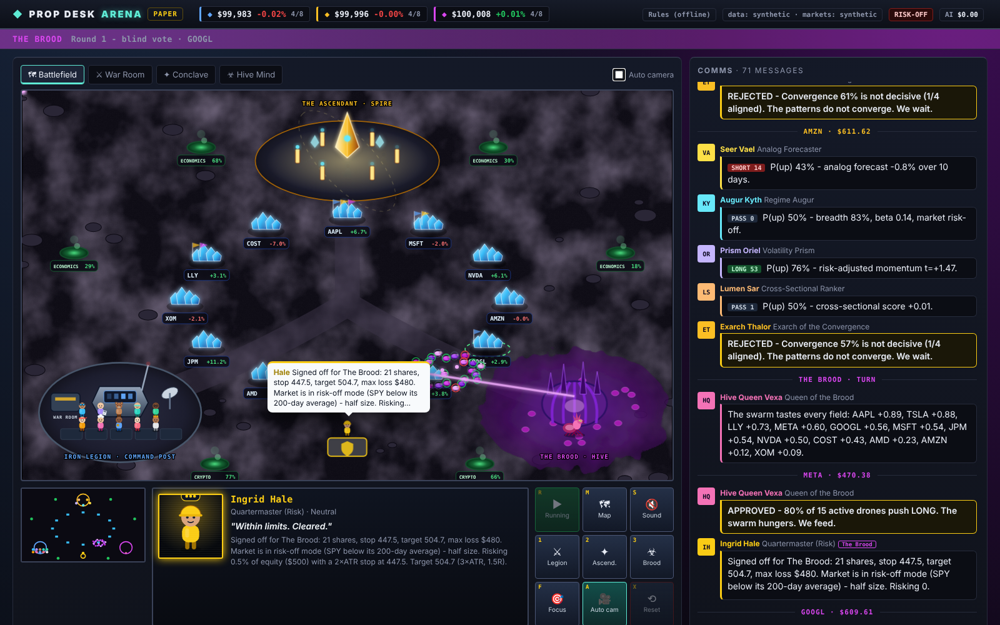
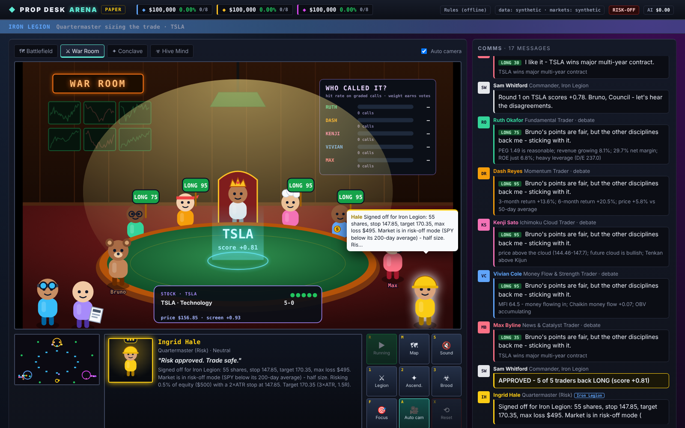
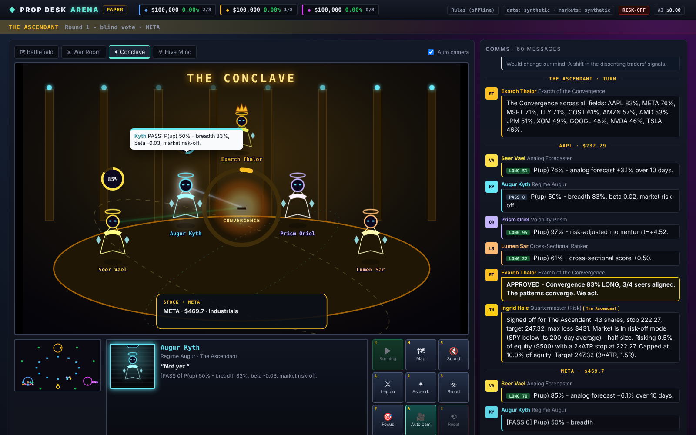
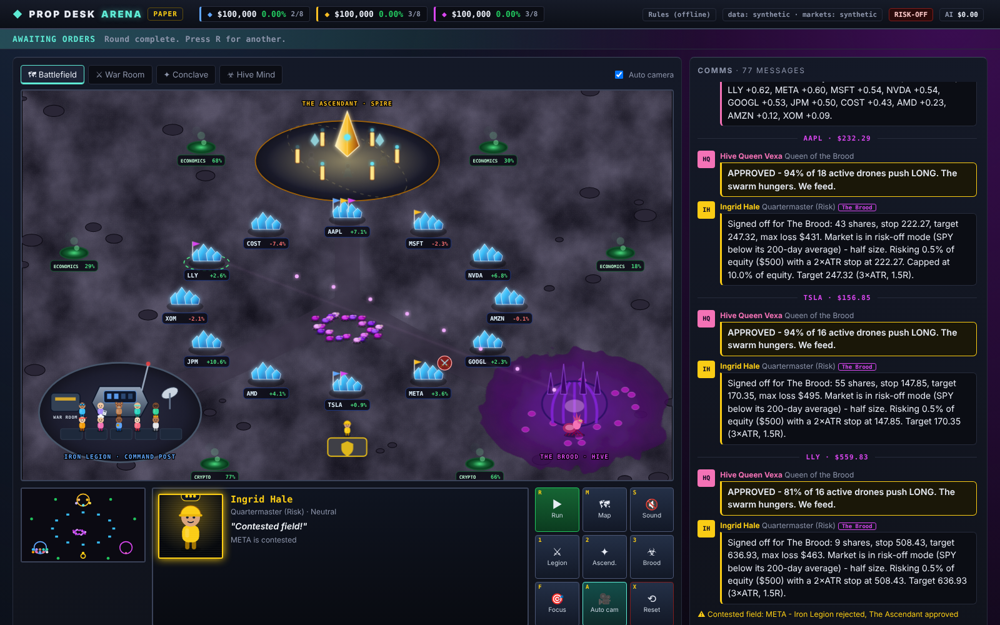

# Prop Desk Arena

Three AI trading factions, one market, one scoreboard. Each faction trades a different philosophy with its
own paper money. They all face the same prices and the same risk rules, and every call they make is graded
afterwards. The question the Arena answers: **which way of trading is actually right more often, and what
does it cost to run?**



> **Paper trading only.** Every faction trades a simulated account that starts at **$100**
> (`prop_desk/data/<faction>/ledger.json`). Nothing here connects to a real brokerage. This is a research tool, not
> financial advice.

## The factions

| | Philosophy | How it decides | AI use |
|---|---|---|---|
| **Iron Legion** | Disciplined specialists | A research agent hunts ideas and a devil's advocate attacks each one. Five discipline traders (fundamental, momentum, Ichimoku cloud, money flow, news) vote blind, debate, and vote again in the **War Room**. Approval needs a ±0.30 score, 3+ traders, and 2+ independent kinds of evidence. | Heavy: about 14 Claude calls per idea, plus an Agent SDK research agent |
| **The Ascendant** | Hyper-advanced quant models | Four seers are pure math: an *analog forecaster* (finds the past 20-day patterns most like today and asks what happened next), a *regime augur* (market trend and breadth × beta), a *volatility prism* (risk-adjusted momentum), and a *cross-sectional ranker*. The Exarch pools their probabilities in log-odds space in the **Conclave** and trades at 55%+ with 3 of 4 seers aligned. | Light: Claude only narrates the verdict (1 call per idea) |
| **The Brood** | Hive mind | 24 single-signal drones (RSI bounce, 20-day breakout, money inflow, gap up…) vote independently, with no debate. The Hive Queen acts when at least 68% of at least 8 active drones agree, in the **Hive Mind**. Drones that keep being wrong lose weight: the swarm evolves. | Light: 1 Claude call per idea |

**Neutral Quartermaster.** Ingrid sizes every faction's trades with the same rules, all enforced in code: 1%
of equity at risk with a 2×ATR stop, a 10% cap per position (50% for currency pairs), 8 positions max, at most
2 positions per sector (crypto and currencies each count as a sector), no trades within 3 days of earnings, half
size when SPY is below its 200-day average, and a halt after a 3% daily loss.

## What they trade

Every round the factions scan one shared universe. On the map each kind of resource has its own look.

| Lane | What | On the map |
|---|---|---|
| Core stocks | 12 large caps (`PROP_DESK_WATCHLIST`) | blue minerals, outer ring |
| Lively stocks | Today's fast movers from Yahoo's screeners (most active, top gainers, small-cap gainers). Only names on a major exchange, at least $2 a share and $5M traded a day. No penny stocks, nothing over-the-counter. If the screener is unreachable, a built-in list (PLTR, SOFI, HOOD, RKLB…) is used. | gold minerals, inner ring |
| Crypto | BTC, ETH, SOL, XRP, DOGE in US dollars, in fractions of a coin | violet shards, west flank |
| Currencies | EUR/USD, GBP/USD, AUD/USD, NZD/USD. All quoted in dollars, so profit is in dollars. No leverage. | teal beacons, east flank |
| Options | Bought calls and puts on the stocks. See below. | flag on the stock |
| Prediction markets | Kalshi, when a faction made no other trade | green gas vents |

**Options are buy-only**, so the most a faction can lose is what it paid.
- **When.** Only on unusually strong signals: Iron Legion at a council score of ±0.50 or more, the Ascendant at
  65%+ (or 35% and below, which buys a put), and the Brood in a frenzy (80% of 10+ active drones). A put is how a
  faction bets on a fall without shorting.
- **What gets bought.** The Quartermaster picks an option 14–45 days out, about 3% out of the money, with a tight
  bid/ask spread. It never picks an expiry past the next earnings date. If one option is too expensive, it tries a
  **debit spread**: buy that strike and sell the next one out. That is cheaper and still has a fixed maximum loss.
- **Limits.** At most 10% of equity per option trade and 20% in options in total.
- **Exits.** At +100%, at −50%, 3 days before expiry, or settled at expiry.
- **Small accounts.** One contract covers 100 shares, so at $100 accounts almost every option is vetoed as too
  expensive, with the price shown in Comms. Options switch on by themselves as an account grows. Raise
  `PROP_DESK_OPTIONS_TRADE_PCT` if you want them sooner, at more risk.
- **Pricing.** Live Yahoo option chains. If no live quote is available, a Black-Scholes model price is used.

**Gas (prediction markets).** A faction that makes no stock trade in a round may go after Kalshi markets. Each
faction estimates the probability its own way, needs at least 5¢ of edge after Kalshi's fees, and sizes at a
quarter of the Kelly bet, capped at 1% of equity per market and 5% in total.

## Seasons: $100 each, 30 days, make the most money

- **Starting stake.** Every faction starts its first season with $100 (`PROP_DESK_CASH`). Stocks are bought in
  **fractional shares** (`PROP_DESK_FRACTIONAL`, minimum order $1), so a $100 account can hold anything on
  the watchlist.
- **The goal.** Each faction tries to make as much money as possible over the season (`PROP_DESK_SEASON_DAYS`,
  default 30), **without taking wild risks to get there**. The season is won on a **risk-adjusted score**: this
  season's return divided by its worst drop from a high point (at least 2%). A loss counts in full.
  - Example: a faction that makes +8% and never drops more than 2% scores 4.0. It beats one that makes +10% on a
    ride that fell 15% along the way, which scores 0.67. Big swings that happen to pay off are mostly luck; the
    score rewards skill.
  - Each standings card shows the return, the worst drop and the score.
- **Reinvesting.** When a season ends, results are recorded with a 🏆 for the winner (best score), and the next season
  starts from each faction's ending equity. Profits are reinvested, losses are carried, and position sizes
  grow or shrink with the account. Open positions carry over.
- **Running all season.** Use a machine that stays on, such as a spare PC, a mini PC or a small cloud server,
  with a schedule:

  ```bash
  PROP_DESK_SCHEDULE_ET="09:45,12:30,15:30" python -m prop_desk.server   # three rounds each weekday, US-Eastern time
  ```

## Scoring: "Who called it?"

Every idea a faction considers becomes a **call**, whether it traded or not. Each unit's individual vote is
graded too.
- Stocks are graded after 5 days: up more than 1% = up, down more than 1% = down, otherwise flat.
- Prediction markets are graded when they settle YES or NO.
- **Net** = right calls minus wrong calls. Each card also shows the hit rate and the faction's AI spend. The
  standings themselves rank by the risk-adjusted score above.
- A unit's track record sets its vote weight inside its faction, between 0.5× and 1.5×. Good units earn a
  louder voice.

**Reset** (X) starts over completely: every account goes back to the starting stake, and every track record
and the season history are wiped.

## Run it

**Handing setup to Claude Code on the spare PC?** Give it [HANDOFF.md](HANDOFF.md): step-by-step instructions
with a check after each step.

**Running a full season on a spare PC?** Follow [SETUP.md](SETUP.md) for step-by-step setup, the health
check (`python -m prop_desk.check`) and keeping it running.

```bash
pip install -r prop_desk/requirements.txt
claude auth login                        # once, with Claude Code: lets the Arena use your Claude plan (or set ANTHROPIC_API_KEY)
python -m prop_desk.server               # open http://localhost:8000
```

**Hotkeys:**

| Key | Action |
|---|---|
| R | Run a round |
| M | Battlefield |
| 1 / 2 / 3 | War Room / Conclave / Hive Mind |
| S | Voices and sound |
| F | Pick tickers |
| A | Auto camera |
| X | New season |

**Voices.** Every callout is an original line written for Prop Desk, spoken by the browser's built-in speech
engine with a different pitch and pace per faction. No audio files are used.

|  |  |  |
|---|---|---|

## Claude: which harness, and how it's paid for

Every Claude call goes through one of two backends. The app picks one automatically, or you can force it with
`PROP_DESK_AI`.

| `PROP_DESK_AI` | Uses | Paid by |
|---|---|---|
| `plan` | The **Claude Agent SDK signed in with your Claude plan** (sign in once with Claude Code: `claude auth login`). No API key needed. | Your plan's usage limits |
| `api` | The Claude API with a Console API key (`ANTHROPIC_API_KEY`) | Per token, or from the monthly API credits that Team and Max plans include |
| `rules` | No Claude at all. Every faction uses its built-in rules. | Free |
| `auto` (default) | An API key if one is set, otherwise your Claude login, otherwise rules | |

- **Council votes and narration** ask for schema-validated answers (`agents/brain.py`). With an API key they call
  the API directly; on your plan they go through the Agent SDK with no tools enabled.
- **Iron Legion's research** is a real Agent SDK agent (`agents/research_agent.py`): an open-ended hunt where
  Claude decides which tools to call. Its tools are an in-process MCP server over the desk's own data (screen,
  symbol reports, prediction markets) plus web search. It has no shell and no file access, and each hunt has a
  spending cap (`PROP_DESK_RESEARCH_BUDGET`, default $1).
- Running on your plan, each call starts a small Claude Code process, so it's a little slower (about 5–10
  seconds per vote, at most 3 at once). Opus uses up plan limits faster; `PROP_DESK_MODEL=claude-sonnet-5-5`
  stretches them. The AI cost shown in the app is what the same usage would cost at API prices.
- References: [Use the Claude Agent SDK with your Claude plan](https://support.claude.com/en/articles/15036540)
  and [monthly API credits](https://support.claude.com/en/articles/17154008).

## Configuration (environment variables)

| Variable | Default | |
|---|---|---|
| `PROP_DESK_FACTIONS` | `legion,ascendant,brood` | which factions compete |
| `PROP_DESK_MODEL` / `PROP_DESK_EFFORT` | `claude-opus-5-5` / `medium` | `claude-sonnet-5-5` is about half the cost |
| `PROP_DESK_WATCHLIST` | 12 large caps | the core stocks |
| `PROP_DESK_ASSETS` | `stocks,lively,crypto,forex,options` | what the factions may trade |
| `PROP_DESK_LIVELY_COUNT` / `_LIVELY_MIN_PRICE` / `_LIVELY_MIN_DOLLAR_VOLUME` | `8` / `2` / `5000000` | today's lively stocks and their filters |
| `PROP_DESK_CRYPTO` / `PROP_DESK_FOREX` | 5 coins / 4 pairs | Yahoo symbols, e.g. `BTC-USD`, `EURUSD=X` |
| `PROP_DESK_CRYPTO_MAX_POS_PCT` / `PROP_DESK_FOREX_MAX_POS_PCT` | `10` / `50` | position caps for coins and currencies |
| `PROP_DESK_OPTIONS_TRADE_PCT` / `_OPTIONS_TOTAL_PCT` | `10` / `20` | option limits, % of equity |
| `PROP_DESK_OPTIONS_MIN_DAYS` / `_MAX_DAYS` / `_TAKE_PROFIT_PCT` / `_STOP_PCT` | `14` / `45` / `100` / `50` | which options, and when to sell |
| `PROP_DESK_CANDIDATES` | `3` | ideas each faction considers per round |
| `PROP_DESK_CASH` | `100` | each faction's stake at the first season |
| `PROP_DESK_SEASON_DAYS` | `30` | season length; ending equity rolls into the next season |
| `PROP_DESK_FRACTIONAL` / `PROP_DESK_MIN_ORDER` | `true` / `1` | fractional shares, smallest order in $ |
| `PROP_DESK_SCHEDULE_ET` | – | fixed weekday run times, US-Eastern (e.g. `09:45,15:30`) |
| `PROP_DESK_THRESHOLD` / `PROP_DESK_QUORUM` / `PROP_DESK_MIN_FAMILIES` | `0.30` / `3` / `2` | Iron Legion's voting rules |
| `PROP_DESK_RISK_PCT`, `_MAX_POS_PCT`, `_MAX_POSITIONS`, `_MAX_PER_SECTOR`, `_MAX_DAILY_LOSS_PCT`, `_EARNINGS_BLACKOUT_DAYS` | 1 / 10 / 8 / 2 / 3 / 3 | Quartermaster's rules |
| `PROP_DESK_KALSHI` / `PROP_DESK_KALSHI_MIN_EDGE` | `true` / `5` | prediction markets on/off, minimum edge in cents |
| `PROP_DESK_CALL_HORIZON_DAYS` | `5` | when stock calls get graded |
| `PROP_DESK_AUTORUN_MINUTES` | `0` | run a round every N minutes during US market hours |
| `PROP_DESK_ALERT_WEBHOOK` | – | Slack-compatible webhook for trade alerts |
| `PROP_DESK_DATA` / `PROP_DESK_KALSHI_DATA` | `auto` | `synthetic` forces simulated data (offline demos) |
| `PROP_DESK_DATA_DIR` | `prop_desk/data` | ledgers, scorecards, session transcripts |

**Cost (Claude mode, Opus, medium effort):** these are estimates.

| Faction | Calls per idea | Approx. cost per idea |
|---|---|---|
| Iron Legion | 13 Claude calls | $0.30–$0.60 |
| Ascendant | 1 call | under 5¢ |
| Brood | 1 call | under 5¢ |

A full round with every faction weighing 3 ideas costs roughly $1–2. Live costs per faction are shown on the
standings cards.

## Code map

```
prop_desk/
  desk.py              the Arena: scouts the market once, then runs each faction's turn
  factions/base.py     what every faction shares: ledger, scorecard, risk + execution, reviews
  factions/legion.py   Iron Legion (War Room council, Agent SDK research, devil's advocate)
  factions/ascendant.py  the Ascendant's four quant models and log-odds pooling
  factions/brood.py    the Brood's 24 drones and the Queen
  agents/              personas, Claude wrapper, Agent SDK research agent, output schemas
  indicators.py        RSI, MACD, ATR, Ichimoku, MFI, CMF, OBV, relative strength
  universe.py          what's tradable today: core + lively stocks, crypto, currencies
  market_data.py       Yahoo Finance + simulated prices (stocks, crypto, currencies)
  options.py           option chains (Yahoo or Black-Scholes), choosing a contract
  season.py            seasons, reinvesting, risk-adjusted score
  kalshi.py            Kalshi read-only market data + simulator, fees and edge
  broker.py            paper ledger + the Quartermaster's rules (stocks, coins, currencies, options, Kalshi)
  scorecard.py         "Who called it?" grading and vote weights
  server.py            FastAPI + WebSocket; static/ is the game UI (plain JS + SVG, no build step)
  tests/               python -m pytest prop_desk/tests
```

**Adding a faction:** subclass `Faction` in `factions/`, implement `stock_turn` (and optionally `gas_turn` and
`quick_view`), add its units to `agents/personas.py`, and register it in `factions/__init__.py`.

## What's tested, and what isn't

- **Tested:** 38 automated tests cover indicators, consensus, every risk rule, Kalshi fees and settlement,
  scoring and weights, crypto and currency sizing, option pricing, caps, spreads and settlement, risk-adjusted
  season scoring, all three factions end to end, Claude-mode paths using a stand-in model, and recovery
  when Claude or the research agent fails. Full rounds were also run in a headless browser at desktop and
  phone widths.
- **Not yet tested:**
  - Yahoo Finance and Kalshi's live API were unreachable from the build environment, so only simulated data
    has been run. That includes the lively-stock screener, live crypto and currency prices, and live option
    chains. The Kalshi client follows Kalshi's documented public market-data format. Run
    `python -m prop_desk.check` on the spare PC to confirm all of them.
  - The new instruments have only been run with the rule-based factions. Claude hasn't traded them live yet.
  - **A full Claude round has been run** on a Claude plan with $100 accounts, using simulated market data.
    It took 5.5 minutes, with no errors, and cost the equivalent of $2.22 at API prices:

    | Faction | API-price equivalent |
    |---|---|
    | Iron Legion | $2.13 |
    | Ascendant | $0.05 |
    | Brood | $0.04 |

    Lessons from that run:
    - The agents noticed that the simulated fundamentals don't add up, and refused to size trades on them.
      Iron Legion will only be judged fairly on real data.
    - Nova's web research is real, so against simulated Kalshi prices it "finds" mispricings that don't
      exist. Use real Kalshi data before trusting any prediction-market results.

## Going live (not built, on purpose)

1. Let the Arena run for several weeks of paper rounds and see which faction's hit rate holds up.
2. Backtest the rule-based factions over years of history.
3. Add a broker-paper adapter (Alpaca or Interactive Brokers) with the same `open/close/mark` interface.
4. If the trading involves your organization's money, bring in your finance committee and counsel first.
