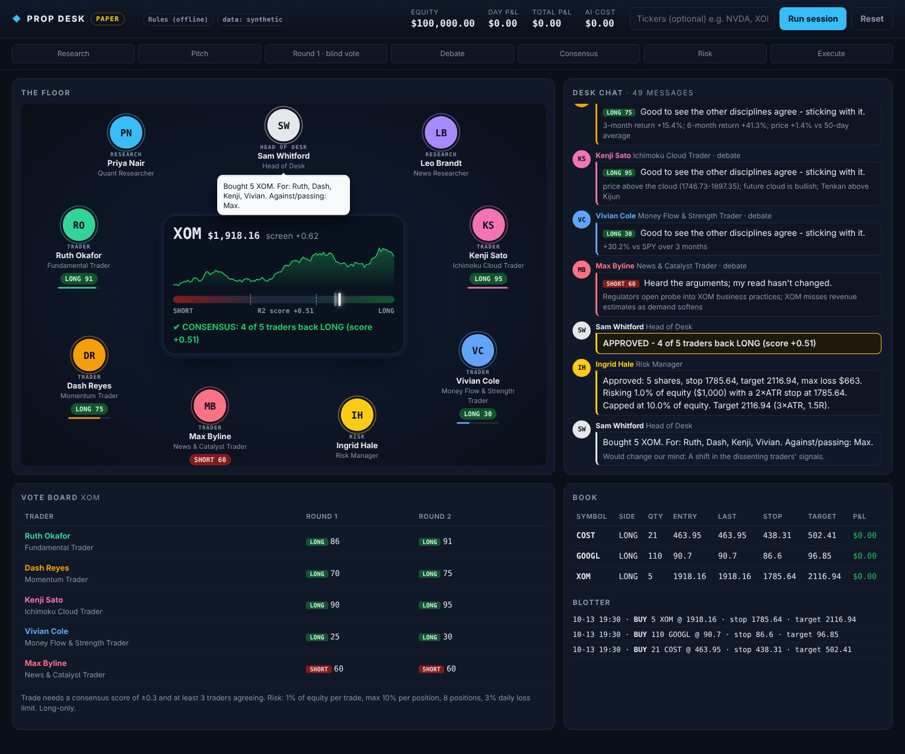

# Prop Desk: a multi-agent AI trading floor

A small "prop firm" made of AI agents. Researchers find trade ideas. Five specialist traders each judge the
idea through their own discipline. They vote blind, debate, and vote again. The trade is placed only if
the floor reaches consensus **and** the risk manager signs off. You watch the whole thing live in a
trading-floor GUI.



> **Paper trading only.** Orders go to a simulated ledger (`data/ledger.json`). Nothing here connects to a
> real brokerage. This is a research tool, not financial advice.

## Run it

```bash
pip install -r prop_desk/requirements.txt
export ANTHROPIC_API_KEY=sk-ant-...      # optional; without it the desk runs on built-in rules
python -m prop_desk.server               # then open http://localhost:8000
```

Click **Run session**. Optionally type tickers (for example `NVDA, XOM`) to make the floor look at specific names
instead of letting the researcher pick.

| Setting | Effect |
|---|---|
| no API key | **Rules mode.** Every agent uses a transparent rule-based version of its discipline. Free, and good for demos and testing. |
| `ANTHROPIC_API_KEY` set | **Claude mode.** Each agent is Claude with its own persona and only its own data. |
| `PROP_DESK_DATA=synthetic` | Use realistic fake market data, for example offline or behind a firewall. The default `auto` uses Yahoo Finance and falls back to synthetic. |

## The floor

| Seat | Who | Looks at |
|---|---|---|
| Quant Researcher | Priya Nair | Screens the whole watchlist and pitches the strongest setups |
| News Researcher | Leo Brandt | Headlines; briefs the floor on what's moving each name |
| Fundamental Trader | Ruth Okafor | P/E, forward P/E, PEG, growth, margins, ROE, leverage, FCF yield |
| Momentum Trader | Dash Reyes | 1w/1m/3m/6m returns, 20/50/200-day averages, RSI, MACD, 52-week highs |
| Ichimoku Cloud Trader | Kenji Sato | Price vs cloud, future cloud, Tenkan/Kijun cross, Chikou span |
| Money Flow & Strength Trader | Vivian Cole | MFI, Chaikin Money Flow, OBV, up/down volume, relative strength vs SPY |
| News & Catalyst Trader | Max Byline | Headlines and catalysts (0.8 vote weight, because news is noisy) |
| Risk Manager | Ingrid Hale | Sizes every trade. **Hard veto. Her rules are code, not AI.** |
| Head of Desk | Sam Whitford | Runs the meeting and writes the plain-English desk memo |

## How a session works

```
Research ─► Pitch ─► Round 1 (blind) ─► Debate (Round 2) ─► Consensus ─► Risk ─► Execute ─► Memo
```

1. **Research.** Every watchlist name gets indicators computed in Python. The quant researcher ranks them and
   brings the top few (`PROP_DESK_CANDIDATES`, default 3) to the floor.
2. **Blind vote.** Each trader sees the pitch plus **only their own data** and votes LONG, SHORT or PASS
   with a 0–100 conviction. Voting blind stops the traders from simply copying each other.
3. **Debate.** Each trader reads the others' arguments and can change their vote. They are told to change
   only when a colleague raises something their own discipline must respect, not to follow the crowd.
4. **Consensus.** `score = Σ(weight × conviction × direction) / Σ(weight × 100)`, which runs from −1 to +1.
   The trade is approved only if |score| ≥ 0.30 **and** at least 3 traders agree, so one loud trader can't force it.
5. **Risk.** Code sizes the position at 1% of equity at risk, with a stop at 2×ATR and a target at 3×ATR. It caps
   any one position at 10% of equity and the book at 8 positions. It halts trading after a 3% daily loss and
   blocks doubling up on a name already held.
6. **Execute and memo.** The order is filled in the paper ledger. Stops and targets are checked at the start of
   each session.

**Design principle: AI for judgement, code for math and money.** Agents never calculate indicators. They
reason over exact numbers from `indicators.py`. Agents never size positions or override limits. That
happens in `broker.py`. Every agent answer is schema-validated JSON (`agents/schemas.py`), never free text.
If Claude errors or declines, that agent falls back to its rule-based view and the session continues.

## Configuration (environment variables)

| Variable | Default | |
|---|---|---|
| `PROP_DESK_MODEL` | `claude-opus-5-5` | `claude-sonnet-5-5` is about half the cost |
| `PROP_DESK_EFFORT` | `medium` | `low` / `medium` / `high`: how hard each agent thinks |
| `PROP_DESK_WATCHLIST` | 12 large caps | comma-separated tickers |
| `PROP_DESK_CANDIDATES` | `3` | ideas brought to the floor per session |
| `PROP_DESK_THRESHOLD` / `PROP_DESK_QUORUM` | `0.30` / `3` | consensus rules |
| `PROP_DESK_RISK_PCT` / `PROP_DESK_MAX_POS_PCT` / `PROP_DESK_MAX_POSITIONS` / `PROP_DESK_MAX_DAILY_LOSS_PCT` | `1` / `10` / `8` / `3` | risk limits |
| `PROP_DESK_ALLOW_SHORTS` | `false` | the desk is long-only by default |
| `PROP_DESK_CASH` | `100000` | paper starting cash |

**Cost (Claude mode).** Each idea takes 13 Claude calls. With Opus at medium effort that's an estimated
$0.30–$0.60 per idea, so a 3-idea session costs about $1–2. The running total is shown in the top bar.

## Code map

```
prop_desk/
  config.py          settings
  market_data.py     Yahoo Finance + synthetic data providers
  indicators.py      RSI, MACD, ATR, Ichimoku, MFI, CMF, OBV, relative strength
  agents/personas.py the team: who they are, what they see, rule-based fallbacks
  agents/brain.py    Claude API wrapper (structured outputs, prompt caching, cost tracking)
  agents/schemas.py  the JSON shapes agents must return
  consensus.py       the voting rules
  broker.py          paper ledger + risk rules
  desk.py            runs a session and streams every step as an event
  server.py          FastAPI + WebSocket
  static/            the trading-floor GUI (plain HTML/CSS/JS, no build step)
  tests/             python -m pytest prop_desk/tests
```

**Adding a trader** (for example an options-flow or mean-reversion trader): write a heuristic function and add a
`Persona` in `agents/personas.py`, add a discipline prompt to `DISCIPLINE_PROMPTS`, then give the new id a
seat position in `SEATS` in `static/floor.js`.

## Going live (not built, on purpose)

Before any real money:
1. **Backtest.** Replay the rule-based desk over several years of history. Claude-mode backtests are expensive and
   can leak hindsight, so validate the rules first.
2. **Paper-trade for weeks** against a broker's paper account (Alpaca and Interactive Brokers both offer one)
   by adding a broker class with the same `open/close/mark` interface as `PaperBroker`.
3. **Better data.** Yahoo is free but delayed and unofficial. Polygon, Alpaca or Tiingo data and a real
   news feed would make the news trader meaningful.
4. **Compliance.** If the trading involves your nonprofit's funds rather than personal money, involve your
   finance committee and counsel. An investment policy statement usually governs this.
